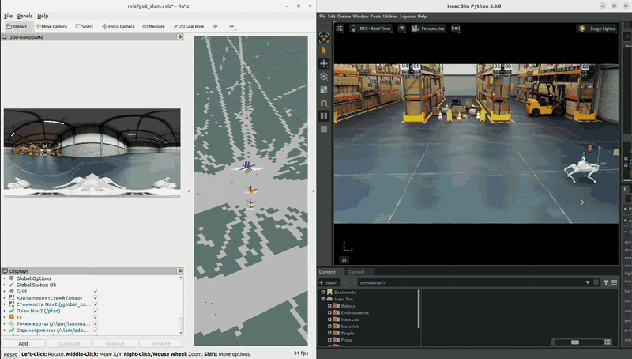
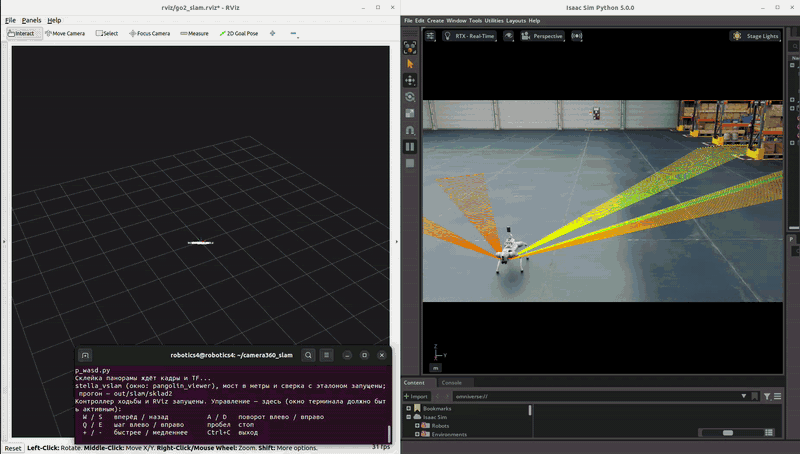
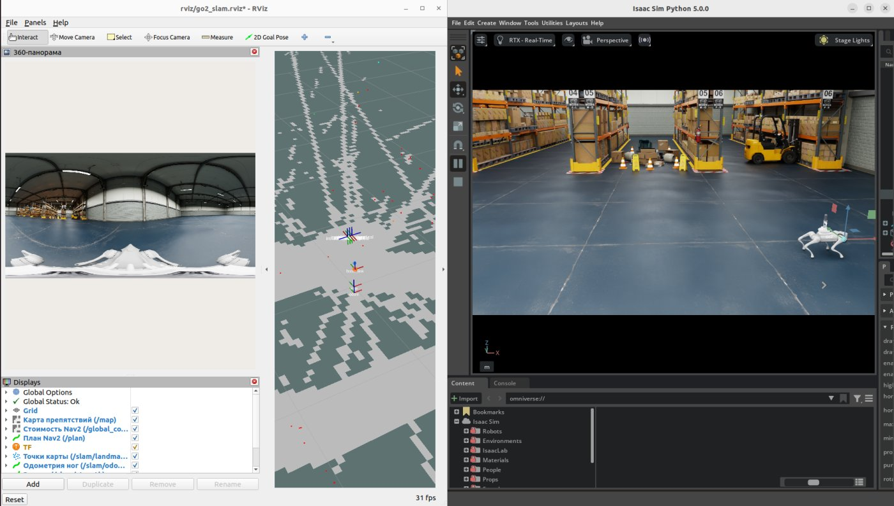
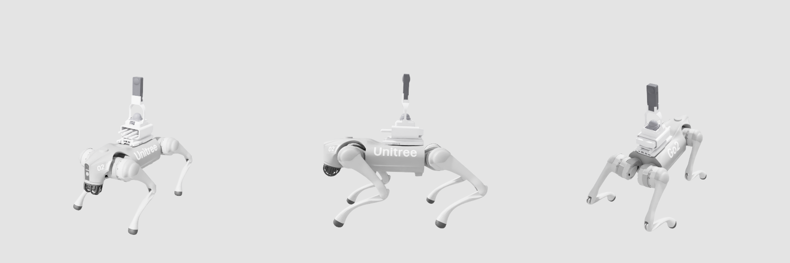
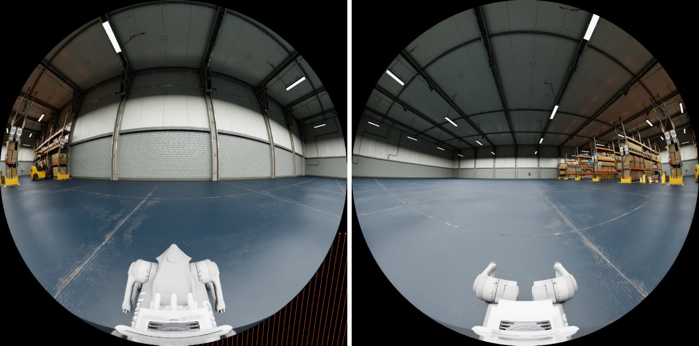
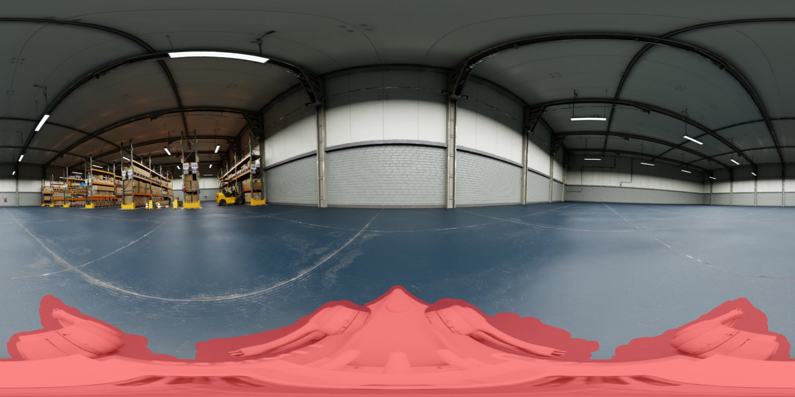
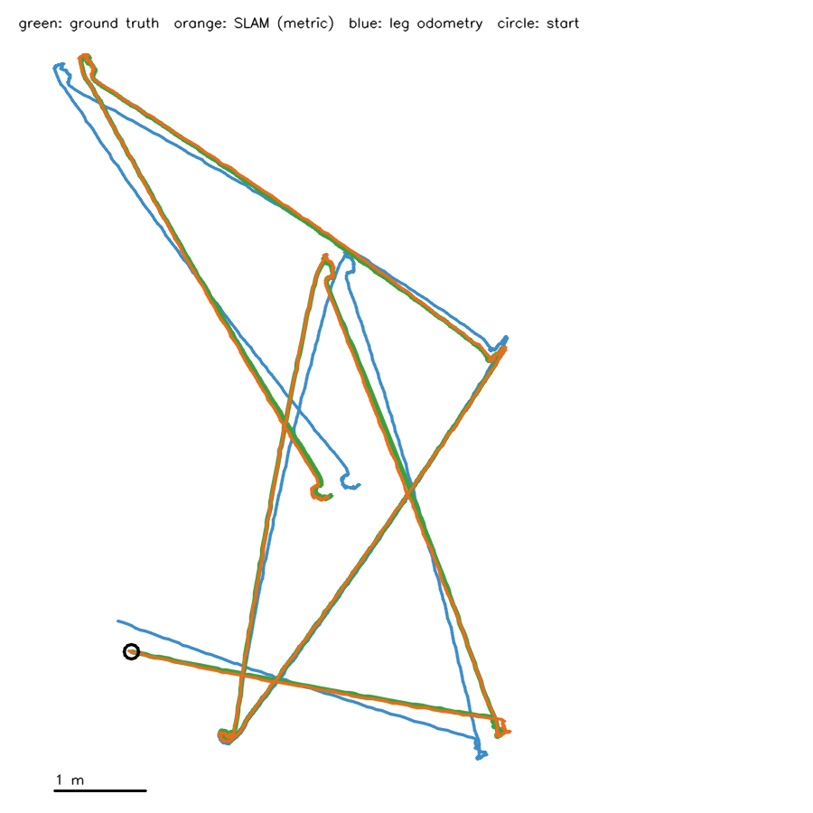
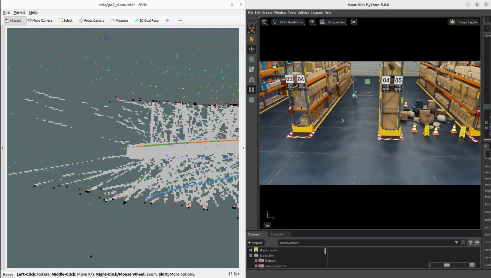
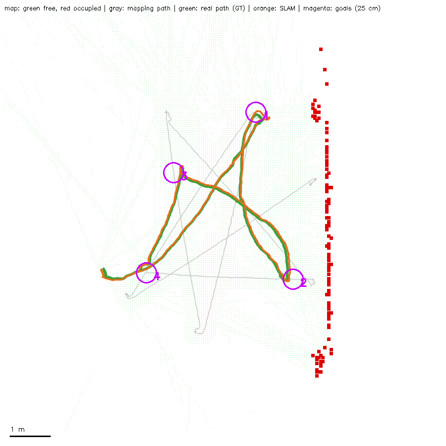
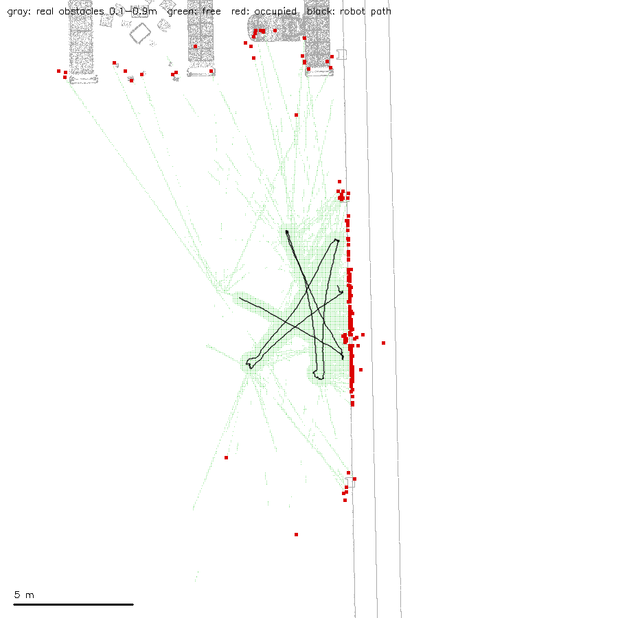

# camera360_slam — Go2 с 360-камерой в Isaac Sim: SLAM и навигация по камере

<p align="center"></p>

**English.** Diploma project: a Unitree Go2 that sees the world **only with a 360° camera**
(Insta360 X5 — two back-to-back 200° fisheye lenses), no lidar. Developed in NVIDIA Isaac Sim
against ground truth: the two fisheyes are stitched into an equirectangular panorama,
[stella_vslam](https://github.com/stella-cv/stella_vslam) tracks it, a bridge turns the
scale-less monocular map into metres using leg odometry and IMU (TF `map -> odom -> base_link`),
SLAM landmarks become an occupancy grid, and Nav2 drives the robot to goals. On a 33 m warehouse
drive SLAM stays within 4–6 cm RMSE of ground truth (leg odometry alone: ~20 cm); the robot reaches
4 of 4 goals on a saved map. Same ROS 2 topics and frames as the real robot will use.
Documentation below is in Russian.

Продолжение дипломного проекта [`3d_mapping`](https://github.com/Andrey-Arsen/go2-mid360-insta360-mapping):
робот Unitree Go2 видит мир **только 360-камерой** Insta360 X5 (два fisheye спина к спине) — без
лидара. SLAM — [stella_vslam](https://stella-cv.readthedocs.io/en/stable/overview.html), навигация —
Nav2. Сначала всё в Isaac Sim (с эталонной позой для сравнения), потом на настоящем роботе: в
симуляции сразу те же имена топиков и кадров, что будут у драйверов.

| SLAM: RViz (точки карты, карта препятствий, пути) и Isaac Sim | Навигация: цель «2D Goal Pose», Go2 идёт сам |
|---|---|
|  |  |

```
Isaac Sim: Go2 + 2 fisheye 200° ──► склейка в 360-панораму 1920x960 (+ маска тела робота)
  ──► stella_vslam (Equirectangular) ──► мост: масштаб и горизонт по одометрии ног и IMU
  ──► TF map -> odom -> base_link, точки карты в метрах ──► карта препятствий /map ──► Nav2 ──► /cmd_vel
```

Готово: Go2 с надстройкой и двумя fisheye в Isaac Sim, ходьба WASD, кадры камеры и TF в ROS 2;
склейка в 360-панораму, stella_vslam по ней, перевод карты в метры, локализация по готовой карте,
сверка с эталоном; Nav2 по карте препятствий из точек SLAM. Дальше — перенос на настоящий Go2.

Машина: Ubuntu 22.04, ROS 2 Humble, Isaac Sim 5.0 в `~/isaacsim`, RTX 5080.
Все команды — из корня проекта `~/camera360_slam`.

## Go2 с 360-камерой (управление WASD)

<p align="center"><br>
<sub>Go2 с надстройкой из Fusion 360: коробка Orin, корпус Mid-360 (датчика нет — только корпус), Insta360 X5 сверху</sub></p>

```bash
scripts/go2_sim.sh
```

Откроется Isaac Sim с Full Warehouse (первый раз склад скачивается несколько минут),
запустится контроллер ходьбы IsaacLegs и RViz (оба fisheye). Рулить — в том же терминале:

| Клавиша | Действие |
|---|---|
| `W` / `S` | вперёд / назад |
| `A` / `D` | поворот влево / вправо |
| `Q` / `E` | шаг влево / вправо |
| пробел | стоп |
| `+` / `-` | быстрее / медленнее (до 1 м/с — так училась политика) |
| `Ctrl+C` | выход (закроет Isaac Sim, контроллер и RViz) |

Клавиша включает движение и оно держится; та же клавиша ещё раз снимает его. Терминал
должен быть активным окном.

Варианты:

```bash
scripts/go2_sim.sh digital_twin_warehouse              # другое окружение
scripts/go2_sim.sh full_warehouse --spawn 2 -3 90      # поставить робота в X Y и повернуть
scripts/go2_sim.sh full_warehouse --image-size 480     # камеры мельче — симуляция быстрее
scripts/go2_sim.sh full_warehouse --lenses front       # только передний объектив
scripts/go2_sim.sh full_warehouse --image-every 3      # кадры 20 Гц вместо 10
WITH_RVIZ=0 scripts/go2_sim.sh                         # без RViz
```

Окружения: `flat_grid`, `simple_room`, `warehouse`, `full_warehouse`, `warehouse_shelves`,
`digital_twin_warehouse` (склад с конвейерами — ближе всего к цеху; отдельной «фабрики» в
ассетах Isaac Sim 5.0 нет), `office`, `hospital` или путь к своему `.usd`.
Журналы — `out/go2_logs/`.

## Камера в ROS 2

| Оба fisheye 200° (передний и задний) | 360-панорама для stella; красное — маска тела робота |
|---|---|
|  |  |


Домен — из `ROS_DOMAIN_ID` (у нас 10). Время — симуляции (`/clock`): все узлы с `use_sim_time`.

| Топик | Что |
|---|---|
| `/insta360/front/image_raw` | передний объектив, `sensor_msgs/Image` rgb8, кадр `insta360_front_optical` |
| `/insta360/back/image_raw` | задний объектив, кадр `insta360_back_optical` |
| `/tf` | `world -> base_link` — эталонная поза робота из симуляции (в режиме SLAM — `world -> base_link_gt`, а `base_link` — от одометрии) |
| `/tf_static` | `base_link -> insta360_link, insta360_front, insta360_back` и их `*_optical` |
| `/clock` | время симуляции |
| `/odom`, `/imu`, `/joint_states`, `/cmd_vel` | робот (IsaacLegs) |

Объектив — равноугольный fisheye 200°, круг изображения вписан в квадратный кадр: пиксель на
расстоянии `r` от центра кадра смотрит под углом `theta = r / (size/2) * 100°` от оси объектива;
`u` — вправо, `v` — вниз (как оптический кадр ROS: Z из объектива, X вправо, Y вниз).
Кадры по умолчанию 960 px, 10 Гц по времени симуляции.

Где камера (`insta360_link` относительно `base_link`): 39.7 мм позади центра корпуса, 364 мм
над ним; объективы — 20.0 мм (передний) и 59.5 мм (задний) позади центра корпуса. Над полом —
631 мм, когда робот стоит (на ходу корпус выше, камера около 0.66 м).

Симуляция идёт медленнее реального времени: на складе без окна примерно 0.5 при двух камерах
по 960 px (кадры 10 Гц по времени симуляции — 5 Гц по стенным часам). Всем узлам ROS —
`use_sim_time`, тогда это не мешает.

Кадры камеры: `insta360_link` — середина между объективами (X вперёд робота, Z вверх),
`insta360_front` / `insta360_back` — объективы (X из объектива наружу). Оптические центры в
симуляции вынесены за купол линзы на модели X5 (см. `scripts/build_go2_camera360.py`): иначе
собственный корпус камеры закрывает край поля и у объективов нет общего перекрытия для склейки.

Внизу обоих кадров виден сам робот (голова и передние приводы — в переднем, задние приводы
и надстройка — в заднем): для SLAM он закрывается маской.

## SLAM по 360-камере (stella_vslam)

```bash
scripts/slam_sim.sh                          # то же, что go2_sim.sh, плюс SLAM; рулить WASD
DRIVE=long scripts/slam_sim.sh               # проехать программу без человека (slam — 7 м, long — 33 м) и выйти
MAP=out/slam/<прогон> scripts/slam_sim.sh    # локализация по готовой карте (карта не меняется)
LENSES=front scripts/slam_sim.sh             # SLAM только по переднему объективу — для сравнения
ODOM_NOISE=0,0 scripts/slam_sim.sh           # одометрия без ошибок (по умолчанию 0.03,0.5 — см. ниже)
VIEWER=none WITH_RVIZ=0 scripts/slam_sim.sh full_warehouse --headless   # без окон
```

Что запускается вдобавок к симуляции:

1. `scripts/equirect.py` — склейка двух fisheye в панораму 1920x960 (`/insta360/equirect/image_raw`,
   как её ждёт модель Equirectangular у stella: середина — вперёд робота) и маска для stella:
   тело робота (`config/robot_mask_*.png`) и места без изображения. Шов — на ±90° от направления
   вперёд, в полосе ±2° кадры смешиваются; склейка точна для предметов в 4 м (`stitch_distance`).
2. stella_vslam (`run_slam` из stella_vslam_ros, конфиг `config/stella_equirect.yaml`) — окно
   карты PangolinViewer. Карта — в своих единицах и осях (кадр `slam_map`): у одной камеры нет
   метрического масштаба.
3. `scripts/odom_tf.py` — одометрия ног (`/odom` IsaacLegs) в TF `odom -> base_link`, крен и тангаж —
   от IMU. В симуляции одометрия почти идеальна, поэтому ей добавляются ошибки настоящей
   одометрии ног: `ODOM_NOISE="масштаб,курс"`, по умолчанию `0.03,0.5` — шаги на 3% длиннее и
   курс уходит на 0.5° на метр (допущение; у настоящего Go2 проверить по записи).
4. `scripts/slam_bridge.py` — мост в метры: горизонт карты — по IMU, масштаб и курс — по
   одометрии на первых 5 м пути, дальше преобразование заморожено (карта не «плывёт» под
   навигацией) и пишется в `map_transform.json`. Публикует TF `map -> odom` (поправка одометрии
   по камере), `/slam/pose`, `/slam/landmarks` (точки карты в метрах). Две страховки: если путь по
   SLAM расходится с одометрией больше чем на 20% (масштаб карты уплыл), держится последняя
   хорошая поправка; короткие скачки SLAM (больше 10 см / 3°, обычно на разворотах) не
   принимаются, пока не продержатся 1 с.
5. `scripts/eval_slam.py` — сверка с эталоном симуляции (кадр `base_link_gt`): SLAM в метрах,
   одометрия без камеры и геометрия самой stella. В RViz (`rviz/go2_slam.rviz`, кадр `map`) —
   точки карты, эталон (зелёный), SLAM (оранжевый), одометрия (синий), панорама.

Дерево кадров — как будет для навигации: `map -> odom -> base_link -> insta360_*`
(`map -> odom` — мост, `odom -> base_link` — одометрия, крепление камеры — `/tf_static`); эталон
симуляции — отдельно, `world -> base_link_gt`.

После выхода (Ctrl+C или конец программы езды) — в `out/slam/<прогон>/`:

| Файл | Что |
|---|---|
| `report.txt` | точность против эталона: SLAM в метрах, одометрия без камеры, геометрия stella; масштаб |
| `trajectory.png` | вид сверху: эталон, SLAM, одометрия |
| `map.msg`, `map_transform.json` | карта stella и её перевод в метры — для локализации: `MAP=out/slam/<прогон>` |
| `frame_trajectory.txt`, `keyframe_trajectory.txt` | траектория от самой stella (в её единицах) |
| `mask.png` | маска панорамы, с которой работала stella |

Результаты (склад, 16.10.2026, ошибки одометрии по умолчанию):

| Прогон | SLAM в метрах (ATE RMSE / макс) | одометрия без камеры | масштаб карты |
|---|---|---|---|
| `long`, 33 м, 6 разворотов, картирование | 4.1–5.7 см / 12 см | 19–21 см / 35–37 см | +0.7…+2.3% |
| `slam`, 7 м, по готовой карте (`MAP=`) | 3.4 см / 7 см | 5.6 см / 8 см | +2.2% |

Ошибка масштаба карты — от одометрии на первых метрах (её +3%): точнее масштаб не станет без
другого метрического источника. Срывов трекинга не было; короткие скачки на разворотах
отсекает мост.

<p align="center"><br>
<sub>33 м по складу: эталон (зелёный), SLAM в метрах (оранжевый), одна одометрия ног (синий)</sub></p>

Один объектив или два — сравнение на одних и тех же кадрах (программа `slam`, 7.8 м): по двум
объективам геометрия stella — RMSE 1.8 см, максимум 3.5 см; только по переднему — 3.1 и 10.9 см.

Маска тела робота делается один раз (и заново — после изменения надстройки):
`scripts/make_robot_mask.sh` — Isaac без окна, робот ходит по программе, сегментация копит
пиксели тела на обоих объективах -> `config/robot_mask_front.png`, `robot_mask_back.png`.

<p align="center"></p>

## Навигация (Nav2) по карте из SLAM

```bash
# 1. Построить карту: проехать (WASD или программой) — SLAM пишет карту stella и карту препятствий
DRIVE=long SLAM_RUN=sklad scripts/slam_sim.sh          # без DRIVE — рулить самому
# 2. Навигация по ней: цель — «2D Goal Pose» в RViz
MAP=out/slam/sklad NAV=1 scripts/slam_sim.sh
#    без человека: цели из пройденного пути (не ближе 0.9 м к препятствиям) — или свои, в кадре map
MAP=out/slam/sklad NAV=1 GOALS=auto scripts/slam_sim.sh
MAP=out/slam/sklad NAV=1 GOALS="3.9,3.8 4.8,-0.3,0" scripts/slam_sim.sh
```

Карта препятствий — `scripts/landmark_grid.py` по точкам карты SLAM (`/slam/landmarks`), клетка 5 см:
луч от камеры до точки — свободно (точку оттуда видели), полоса вдоль пройденного пути — свободно,
точка на высоте 0.10–0.90 м над полом — занято (робот с камерой — около 0.75 м); точки выше (потолок,
верх стеллажей) не учитываются. Публикуется как `/map`; при картировании пишется в папку прогона:
`map.pgm` + `map.yaml` (формат map_server Nav2) и `landmarks.npz` (точки и путь — пересобрать карту
без прогона). При навигации по готовой карте (`MAP=`) публикуется сохранённая.

Nav2 — `config/nav2.launch.py` (узлы nav2_bringup) и `scripts/nav2_lifecycle.py` вместо стандартного
менеджера жизненного цикла: FastDDS в Humble под нагрузкой теряет ответ сервиса смены состояния, и
менеджер ждал его вечно — Nav2 не включался, цели из RViz никто не принимал; скрипт проверяет
состояние каждого узла и повторяет непрошедший переход (журнал — `out/go2_logs/nav2_lifecycle.log`).
Параметры — `config/nav2_params.yaml`: контроллер Regulated Pure Pursuit, 0.4 м/с, развороты 0.6 рад/с, след
робота 0.70 x 0.40 м, раздувание препятствий 0.5 м; обе карты стоимости — только по `/map` (другого
датчика препятствий нет), неизвестные клетки для планировщика проходимы. Телеуправление WASD теперь
шлёт `/cmd_vel` только пока нажата клавиша — в остальное время робота ведёт Nav2.

Проверка без человека (склад, 16.10.2026): карта по программе `long` (33 м) -> навигация по ней к
4 целям (`GOALS=auto`): все 4 достигнуты; по эталону робот останавливался в 15–34 см от цели (в
среднем 25 см — это допуск «дошёл» Nav2, 0.25 м); SLAM за поездку — RMSE 6.3 см против 13 см у одной
одометрии. Отчёт целей — `nav_report.txt` в папке прогона.

| Навигация по 4 целям (круги 25 см): путь по эталону и по SLAM | Карта препятствий из точек SLAM против настоящих препятствий склада |
|---|---|
|  |  |

<sub>Справа: серое — настоящие препятствия на высоте 0.1–0.9 м (меш склада), красное — занятые клетки карты, зелёное — свободные, чёрное — путь робота.</sub>

Ограничения карты препятствий по камере: точек мало (на 33 м — около 2800, на высоте препятствий
около 16%), поэтому препятствия без текстуры не видны, а неразведанные места неизвестны —
планировщик может повести через них; живых препятствий (люди, тележки) робот не видит — для этого
нужна плотная глубина по камере.

## Если что-то не так

- **Робот падает сразу при старте, SLAM скачет, Nav2 не включается.** Скорее всего, работают
  процессы прошлого запуска (уборку при выходе прервали вторым Ctrl+C или закрыли терминал): два
  контроллера ходьбы валят робота, две одометрии и две склейки сбивают SLAM. Лаунчер теперь сам
  это проверяет и не стартует; закрыть остатки — `scripts/stop_all.sh` (показать — `--list`).
  Выход — один Ctrl+C и подождать: stella пишет карту, сверка — отчёт, это до минуты.
- **Цели из RViz не принимаются.** Дождитесь в терминале строки `[nav2] Nav2 активен — цели
  принимаются`; журнал включения — `out/go2_logs/nav2_lifecycle.log`, Nav2 — `out/go2_logs/nav2.log`.
- **Робот падает под нагрузкой (окна Isaac, RViz, окно карты).** Контроллер ходьбы запускается с
  одним потоком torch (`OMP_NUM_THREADS=1`): со всеми потоками шаг политики под полной загрузкой
  процессора рос с 0.04 до 18–33 мс, команды суставам опаздывали.

## Проверки

```bash
# при запущенном scripts/go2_sim.sh, в другом терминале:
source /opt/ros/humble/setup.bash && python3 scripts/check_cameras.py
#   частота и размер кадров, круг изображения, TF камеры; кадры -> out/check/front.png, back.png

# как Go2 стоит с надстройкой (без политики, на полу): высота корпуса, камеры, наклон
~/isaacsim/python.sh scripts/check_go2_stand.py --compare   # -> robot/go2_camera360/stand_check.png
```

## Надстройка из Fusion 360

Надстройка (`robot/go2_sensor_mount`: URDF и сетки) — копия из `~/3d_mapping`, там же скрипт,
который делает её из экспорта Fusion (`scripts/mount_urdf.py`, ему нужен `.venv` 3d_mapping).
После изменений в Fusion:

```bash
cd ~/3d_mapping && .venv/bin/python scripts/mount_urdf.py "<папка экспорта>" --front -y --mass-mount 0.8
cp -r ~/3d_mapping/robot/go2_sensor_mount/{urdf,meshes} ~/camera360_slam/robot/go2_sensor_mount/
cd ~/camera360_slam && ~/isaacsim/python.sh scripts/build_go2_camera360.py
~/isaacsim/python.sh scripts/check_go2_stand.py --compare
```

Корпус Mid-360 остаётся частью надстройки (камера его видит, его масса учтена), но самого
лидара в сцене нет.

## Что в проекте

| Путь | Что |
|---|---|
| `scripts/go2_sim.sh` | запуск: Isaac Sim + контроллер ходьбы + RViz + WASD (`SLAM=1` — со SLAM) |
| `scripts/slam_sim.sh` | то же со SLAM: склейка, stella_vslam, сверка с эталоном |
| `scripts/run_go2_isaac.py` | Isaac Sim: сцена, окружение, публикация камеры (`ros2_cameras.py`), маска робота |
| `scripts/build_go2_camera360.py` | собрать робота: Go2 IsaacLegs + надстройка + два fisheye -> `robot/go2_camera360/` |
| `scripts/equirect.py` | склейка двух fisheye в 360-панораму + маска для stella |
| `scripts/odom_tf.py` | одометрия ног -> TF `odom -> base_link` (с ошибками настоящей) |
| `scripts/slam_bridge.py` | карта stella -> метры, TF `map -> odom`, точки карты |
| `scripts/eval_slam.py` | сверка SLAM с эталоном симуляции |
| `scripts/drive_pattern.py` | езда по программе (`slam`, `long`, `mask`) без человека |
| `scripts/landmark_grid.py` | карта препятствий `/map` из точек SLAM (+ `map.pgm`/`map.yaml`) |
| `scripts/nav_goals.py` | цели для Nav2 по очереди и отчёт, куда робот пришёл |
| `scripts/nav2_lifecycle.py` | включение узлов Nav2 с проверкой состояния (вместо nav2_lifecycle_manager) |
| `scripts/make_robot_mask.sh` | маска тела робота -> `config/robot_mask_*.png` |
| `scripts/install_stella.sh`, `scripts/slam_env.sh` | сборка stella_vslam в `third_party/stella`, её окружение |
| `scripts/check_cameras.py`, `scripts/check_go2_stand.py` | проверки (см. ниже) |
| `scripts/teleop_wasd.py` | WASD -> `/cmd_vel` |
| `scripts/stop_all.sh` | закрыть процессы проекта, оставшиеся от прошлого запуска (`--list` — показать) |
| `config/` | конфиг stella, маски тела робота, Nav2 (`nav2.launch.py`, `nav2_params.yaml`) |
| `patches/stella_vslam_ros.patch` | наши правки обёртки stella: QoS кадров, точки карты `~/landmarks` |
| `robot/go2_sensor_mount/` | надстройка (URDF + STL из Fusion) |
| `robot/go2_camera360/` | собранный робот для Isaac Sim (USD) |
| `rviz/go2_camera360.rviz`, `rviz/go2_slam.rviz` | RViz: оба fisheye; панорама и пути SLAM/эталона |
| `third_party/` | IsaacLegs, torch, stella_vslam (не входят в проект, см. «Установка») |
| `out/` | журналы, прогоны SLAM (`out/slam/`), кадры проверок |
| `docs/media/` | картинки и GIF для этого README |

Лицензия нашего кода — MIT (`LICENSE`); у чужих проектов (IsaacLegs, stella_vslam, Nav2 и др.) — свои.

## Установка с нуля (один раз)

```bash
# IsaacLegs (Go2, контроллер ходьбы) и torch для контроллера — в third_party/
git clone https://github.com/gholibqasobov/IsaacLegs.git third_party/IsaacLegs
(cd third_party/IsaacLegs && source /opt/ros/humble/setup.bash && colcon build --symlink-install)
python3 -m pip install --target third_party/pydeps --index-url https://download.pytorch.org/whl/cpu torch==2.5.1

# Робот для Isaac Sim (нужен интернет: модель Go2 — с сервера NVIDIA)
~/isaacsim/python.sh scripts/build_go2_camera360.py

# stella_vslam + окно PangolinViewer + stella_vslam_ros — в third_party/stella, без sudo (~1 мин);
# нужные apt-пакеты перечислены в шапке скрипта (на рабочей машине уже стоят)
scripts/install_stella.sh

# Маска тела робота для SLAM (~2 мин, без окна)
scripts/make_robot_mask.sh

# Nav2 для навигации (на рабочей машине уже стоит)
sudo apt install ros-humble-navigation2 ros-humble-nav2-bringup
```

В stella_vslam_ros две правки (`patches/stella_vslam_ros.patch`, накладывает `install_stella.sh`):
кадры принимаются с QoS RELIABLE вместо BEST_EFFORT — иначе панорамы по 5.5 МБ терялись больше
чем наполовину и трекинг срывался; и публикация точек карты `~/landmarks`.

На этой машине `third_party/IsaacLegs` и `third_party/pydeps` — ссылки на те же папки в
`~/3d_mapping` (диск почти полон, копии заняли бы ещё 1 ГБ). Если `~/3d_mapping` убрать —
удалить ссылки и поставить по командам выше.

## Благодарности / Credits

- **[IsaacLegs](https://github.com/gholibqasobov/IsaacLegs)** (gholibqasobov) — всё движение
  робота: Go2 в Isaac Sim с графами ROS 2, политика ходьбы из Isaac Lab, контроллер
  `fullbody_controller`.
- **[stella_vslam](https://github.com/stella-cv/stella_vslam)** — визуальный SLAM (модель
  Equirectangular для 360-камер), [stella_vslam_ros](https://github.com/stella-cv/stella_vslam_ros),
  [pangolin_viewer](https://github.com/stella-cv/pangolin_viewer); конфиг панорамы — по их примеру
  для RICOH THETA S. [Pangolin](https://github.com/stevenlovegrove/Pangolin) — окно карты.
- **[Nav2](https://github.com/ros-navigation/navigation2)** — навигация (планировщик, Regulated Pure Pursuit,
  карты стоимости); параметры — по их nav2_bringup для Humble.
- [NVIDIA Isaac Sim](https://developer.nvidia.com/isaac/sim), ROS 2.
